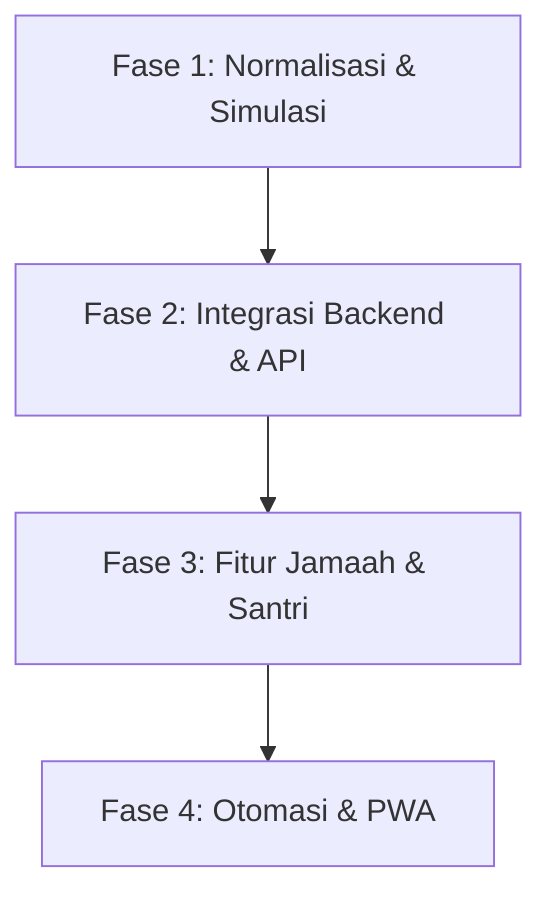

# Rencana Aktivitas & Roadmap Pengembangan Digital Masjid Al Ikhlas

Dokumen perencanaan ini merinci peta jalan (roadmap) pengembangan teknis ekosistem digital Masjid Al Ikhlas Cipta Greenville untuk fase-fase selanjutnya.

---

## 📅 Roadmap Pengembangan Sistem

---

## 📋 Detail Rencana Kerja per Fase

### 🛠️ Fase 2: Integrasi API & Backend (Fokus Utama Berikutnya)
Tujuan dari fase ini adalah mengubah seluruh data tiruan (*mock data*) yang saat ini berjalan secara lokal di browser menjadi data riil yang terhubung dengan database dinamis.

*   **Penyambungan Google Sheets API**:
    *   Mengintegrasikan modul keuangan (/app/keuangan dan /transparansi) ke spreadsheet DKM.
    *   Setiap kali bendahara mencatat uang masuk/keluar di Google Sheets, website publik dan dashboard akan terperbarui secara instan.
*   **Database Artikel Warta**:
    *   Membuat REST API atau menggunakan database serverless (seperti Supabase atau Firebase) untuk menyimpan artikel kabar masjid.
    *   Tombol *Tulis Artikel* di `/app/kabar` akan menyimpan data secara permanen dan menampilkannya di halaman `/kabar` publik.
*   **Autentikasi Riil (Auth)**:
    *   Mengubah fungsi login proteksi rute `/app` agar menggunakan token JWT atau penyedia auth (seperti Firebase Auth / Supabase Auth).

### 💬 Fase 3: Integrasi WhatsApp Gateway & Otomasi Notifikasi
Meningkatkan kemudahan interaksi antara jamaah dan pengurus dengan memanfaatkan otomasi pesan WhatsApp.

*   **Notifikasi Infaq & Donasi Masuk**:
    *   Saat jamaah selesai mengonfirmasi donasi (melalui form web), pengurus menerima pesan notifikasi WhatsApp untuk verifikasi cepat.
    *   Setelah diverifikasi, jamaah menerima tanda terima (*e-receipt*) resmi dari DKM Al Ikhlas via WhatsApp.
*   **Pendaftaran Santri TPQ**:
    *   Wali santri mendaftar di web ➔ DKM menyetujui di panel admin ➔ Notifikasi detail kelas dan ustadz dikirim otomatis via WhatsApp ke wali santri.

### 🏫 Fase 4: Portal Wali Santri & Evaluasi TPQ
Membuat sistem manajemen pendidikan TPQ Masjid Al Ikhlas lebih terstruktur.

*   **Buku Penghubung Digital**:
    *   Ustadz/ustadzah dapat menginput absensi dan materi hafalan harian santri di panel admin.
    *   Orang tua dapat login ke portal jamaah untuk melihat laporan harian perkembangan membaca Qur'an dan hafalan Juz 30 anak mereka.
*   **Kalender Kegiatan & Agenda Interaktif**:
    *   Halaman agenda publik terhubung ke Google Calendar masjid.
    *   Jamaah dapat menyetel pengingat otomatis untuk kajian rutin mingguan atau event besar hari besar Islam.

### 📱 Fase 5: Progressive Web App (PWA) & Offline Access
Mempermudah jamaah mengakses informasi masjid di dalam area perumahan Cipta Greenville.

*   **PWA Installation**:
    *   Menambahkan manifest dan service worker agar website bisa di-install langsung di HP android/iOS tanpa melalui Play Store.
*   **Offline Mode**:
    *   Menyimpan jadwal sholat hari ini dan peta area masjid di penyimpanan lokal (*cache*), sehingga tetap dapat dibuka meskipun jamaah kehilangan sinyal di dalam ruangan masjid.

---

## 🛠️ Rekomendasi Teknologi Stack Pendukung

Untuk mendukung perencanaan di atas secara efisien dan hemat biaya (cost-efficient), berikut rekomendasi teknologi yang dapat digunakan:

| Kebutuhan Sistem | Teknologi Direkomendasikan | Alasan & Keuntungan |
| :--- | :--- | :--- |
| **Hosting & Serverless** | Netlify / Vercel | Sangat cepat, mendukung deploy otomatis dari Git, dan memiliki fitur serverless functions gratis. |
| **Database & Auth** | Supabase (PostgreSQL) | Menyediakan database PostgreSQL instan dengan sistem keamanan/auth terintegrasi yang mudah digunakan. |
| **Integrasi Spreadsheet** | Google Sheets API v4 | Menghubungkan kas manual bendahara ke website tanpa memerlukan panel input keuangan yang rumit. |
| **WhatsApp API Gateway** | Fonnte / Twilio | Integrasi gateway nomor lokal Indonesia yang stabil dengan harga terjangkau. |
