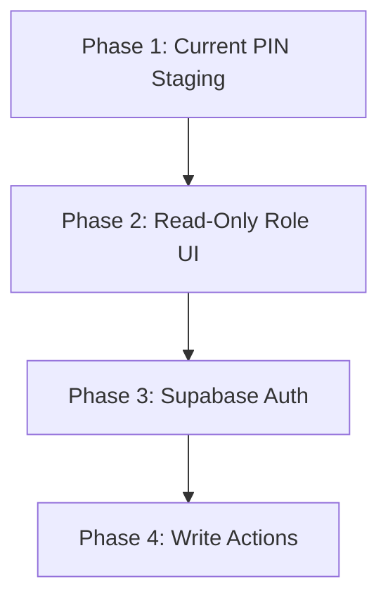

# Rencana Keamanan & Otentikasi Produksi (AUTH_SECURITY_PLAN)
## Masjid Al Ikhlas CGV Digital Ecosystem

Dokumen ini mendefinisikan peta jalan (*roadmap*) dan arsitektur otentikasi serta otorisasi tingkat produksi sebelum mengaktifkan aksi penulisan (*write actions*) pada ekosistem digital Masjid Al Ikhlas Cipta Greenville.

---

## 🚫 1. Kerentanan Variabel Lingkungan Frontend (VITE_*)

Dalam arsitektur Single Page Application (SPA) berbasis React, variabel lingkungan yang diawali dengan `VITE_` (misalnya `VITE_ADMIN_PIN`) memiliki karakteristik sebagai berikut:
*   **Hanya Untuk Konfigurasi Waktu Kompilasi (*Build-time*)**: Variabel ini disuntikkan ke dalam bundel JavaScript statis saat proses build berjalan (`npm run build`).
*   **Terekspos Sepenuhnya ke Publik**: Semua kode JavaScript dikirim ke browser pengguna. Siapa pun dapat membuka Developer Tools (F12), memeriksa tab *Sources*, atau membaca bundel JS untuk mengekstrak nilai variabel lingkungan tersebut.
*   **Bukan Gerbang Keamanan**: Menggunakan `VITE_` untuk menyimpan kredensial, kunci akses, atau PIN rahasia **tidaklah aman** untuk otentikasi multi-pengguna. Gerbang ini hanya berguna sebagai filter pratinjau (*staging gate*) sederhana, bukan sebagai pelindung data sensitif.

---

## ⚡ 2. Supabase Auth Sebagai Rekomendasi Solusi Produksi

Untuk beralih ke otentikasi multi-pengguna yang aman dan berskala produksi, kami merekomendasikan **Supabase Auth** karena alasan berikut:
1.  **Pengelolaan Sesi Berbasis Standar**: Menggunakan standar industri JWT (JSON Web Tokens) dengan mekanisme *refresh token* otomatis yang aman.
2.  **Row-Level Security (RLS)**: PostgreSQL dari Supabase memungkinkan pembatasan akses data langsung pada level database berdasarkan ID pengguna yang masuk, mencegah bypass dari sisi client.
3.  **Dukungan Multi-Faktor (MFA)**: Memudahkan penambahan verifikasi tambahan untuk tindakan sensitif (seperti pengeluaran kas bernominal besar).
4.  **Integrasi Peran Pengguna (User Metadata/Custom Claims)**: Informasi peran (*roles*) dapat disisipkan langsung ke dalam klaim token JWT, memudahkan pemeriksaan otorisasi yang cepat dan aman.

---

## 👥 3. Definisi Peran Pengguna (User Roles)

Sistem akan membagi hak akses ke dalam 5 peran utama:

1.  **`superadmin`**:
    *   Memiliki kontrol penuh atas seluruh sistem.
    *   Dapat mengelola akun pengurus lain, menetapkan peran, serta mengakses seluruh rute dan aksi penulisan.
2.  **`bendahara`**:
    *   Pengelola tunggal keuangan masjid.
    *   Memiliki hak menulis pada modul Keuangan dan Donasi.
3.  **`sekretaris`**:
    *   Pengelola administrasi umum, konten informasi, dan dokumen resmi.
    *   Memiliki hak menulis pada modul Program, Agenda, dan Laporan Dokumen.
4.  **`ustadz_guru`**:
    *   Tenaga pengajar TPQ Al Mardhotillah.
    *   Memiliki hak menulis terbatas pada modul TPQ & Pendidikan (misal: kehadiran santri, nilai raport).
5.  **`viewer`**:
    *   Sesi baca-saja (*read-only*) untuk pengurus DKM umum atau badan pengawas.
    *   Dapat melihat ringkasan seluruh modul tanpa hak melakukan modifikasi data.

---

## 🚦 4. Matriks Izin Akses Rute (Route Permissions)

Berikut adalah izin akses rute berdasarkan peran pengguna:

| Rute Modul | Path Rute | `superadmin` | `bendahara` | `sekretaris` | `ustadz_guru` | `viewer` |
| :--- | :--- | :---: | :---: | :---: | :---: | :---: |
| **Dashboard** | `/app` | 👁️ / ✍️ | 👁️ / ✍️ | 👁️ / ✍️ | 👁️ | 👁️ |
| **Keuangan** | `/app/keuangan` | 👁️ / ✍️ | 👁️ / ✍️ | 👁️ | ❌ | 👁️ |
| **Laporan** | `/app/laporan` | 👁️ / ✍️ | 👁️ | 👁️ / ✍️ | ❌ | 👁️ |
| **Program** | `/app/program` | 👁️ / ✍️ | 👁️ | 👁️ / ✍️ | 👁️ | 👁️ |
| **Agenda** | `/app/agenda` | 👁️ / ✍️ | 👁️ | 👁️ / ✍️ | 👁️ | 👁️ |
| **Donasi** | `/app/donasi` | 👁️ / ✍️ | 👁️ / ✍️ | 👁️ | ❌ | 👁️ |
| **Pendidikan** | `/tpq` | 👁️ / ✍️ | ❌ | 👁️ | 👁️ / ✍️ | 👁️ |

> *Keterangan: 👁️ = Akses Baca (Read-only), ✍️ = Akses Tulis (Write), ❌ = Tidak Ada Akses.*

---

## ✍️ 5. Aturan Aksi Penulisan Masa Depan (Write Actions Rules)

Saat aksi penulisan diaktifkan, aturan validasi backend berikut wajib diterapkan:
1.  **Validasi Token Sesi**: Setiap request perubahan data ke backend (GAS / Supabase API) harus menyertakan Header `Authorization: Bearer <JWT>`. Backend wajib memverifikasi tanda tangan token sebelum memproses data.
2.  **Pengecekan Peran Backend**: Validasi otorisasi peran harus dilakukan di sisi backend. Perubahan data keuangan hanya boleh diproses jika klaim peran dalam token adalah `superadmin` atau `bendahara`.
3.  **Sanitasi Data**: Semua data input harus disanitasi untuk mencegah injeksi kode berbahaya (XSS & SQL Injection).

---

## 📝 6. Persyaratan Log Audit (Audit Trail)

Untuk menjaga prinsip akuntabilitas dan transparansi, setiap aksi penulisan wajib mencatat entri log audit secara otomatis dengan skema berikut:
*   `id`: UUID entri log.
*   `user_id`: ID pengguna pelaku aksi (dari klaim token JWT).
*   `username`: Nama akun pelaku aksi.
*   `action`: Jenis aksi (misal: `INSERT_TRANSACTION`, `DELETE_AGENDA`, `UPDATE_PROGRAM`).
*   `timestamp`: Waktu pencatatan (UTC / Waktu Lokal Batam).
*   `payload_before`: JSON data sebelum diubah (kosong jika penambahan baru).
*   `payload_after`: JSON data setelah diubah (kosong jika penghapusan).
*   `ip_address`: Alamat IP asal request.

---

## 🗺️ 7. Peta Jalan Migrasi Keamanan (Migration Path)

*   **Fase 1: PIN Staging Saat Ini**
    *   *Status*: **Aktif**.
    *   *Fokus*: Pembatasan akses global menggunakan gerbang PIN statis sementara di frontend untuk kebutuhan uji coba fungsionalitas UI.
*   **Fase 2: UI Peran Read-Only**
    *   *Fokus*: Memodifikasi UI Dashboard agar menyembunyikan atau menampilkan tombol aksi, input, dan menu secara dinamis berdasarkan simulasi peran (tanpa koneksi server otentikasi).
*   **Fase 3: Integrasi Supabase Auth**
    *   *Fokus*: Menghubungkan aplikasi React dengan layanan otentikasi Supabase, mengganti simulasi lokal dengan token JWT asli, serta mengamankan endpoint API backend (GAS / Edge Functions).
*   **Fase 4: Aktivasi Aksi Penulisan (Write Actions)**
    *   *Fokus*: Mengaktifkan form tambah, ubah, dan hapus pada UI, mengaktifkan RLS postgres, dan mengintegrasikan logger log audit pada server.
