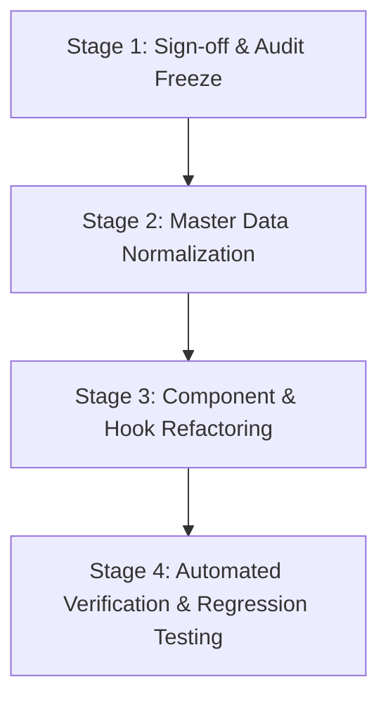

# Finance Reconciliation Plan

**Document Version**: 1.0  
**Date**: 2026-07-25  
**Project**: Masjid Al Ikhlas CGV Digital Ecosystem  
**Purpose**: Detailed roadmap for resolving financial data conflicts between May/June 2026 sources once official confirmation is received from Bendahara DKM Al Ikhlas.

---

## 1. Data Classification Overview

### A. Confirmed & Safe Data (To Preserve As-Is)
- **Official DKM Bank Information**: Bank BSI, Account No. `1500600069`, Account Name `Masjid Al Ikhlas Cipta Green Ville`, NMID `ID1024337942592` ([`siteContent.js`](file:///C:/Users/lenovo/Desktop/afiryu-project/Masjid%20Al%20Ikhlas/alikhlas-cgv-v2/src/data/siteContent.js#L238-L247)).
- **Program & Category Schemas**: Standard category taxonomy (`Infaq Jumat`, `Infaq Event`, `Infaq Cluster`, `Bisyaroh`, `Operasional`, `Jumber`).
- **GAS API Integration Architecture**: GET-only API structure in [`api.js`](file:///C:/Users/lenovo/Desktop/afiryu-project/Masjid%20Al%20Ikhlas/alikhlas-cgv-v2/src/services/api.js#L184-L260) with strict fallback mechanism.

### B. Disputed Figures (Must Remain Freeze-Locked Until Official Approval)
- **May 2026 Figures**:
  - Version A: Income Rp 19.069.526, Expense Rp 5.599.396, Ending Rp 13.470.130
  - Version B: Income Rp 19.431.000, Expense Rp 8.268.292, Ending Rp 11.162.708
  *Action*: Do not modify any runtime values in `src/` until Bendahara sign-off.
- **June 2026 Figures**:
  - Summary Card: Income Rp 12.850.000, Expense Rp 7.650.000, Ending Rp 5.200.000
  - Transaction Array: `mockTransactionsJuni` (42 records totaling Rp 19.431.000 in, Rp 6.149.396 out)
  *Action*: Do not alter runtime arrays or summary cards until Bendahara sign-off.

### C. UI Elements Recommended for Temporary Flagging or Hiding
1. **June Mock Transaction Table in Admin/Public**:
   - *Issue*: Backing array `mockTransactionsJuni` is an exact clone of May data.
   - *Recommendation*: Add a UI badge `"Dalam Peninjauan (Data Mock)"` or temporarily hide the detailed table on public views until real June transaction data is uploaded by Bendahara.
2. **Budget Realization Progress Bars**:
   - *Issue*: Displays cost allocation percentages rather than target achievement.
   - *Recommendation*: Relabel header from `"Realisasi Anggaran"` to `"Alokasi Pengeluaran Bulanan"` OR hide progress bars until approved target amounts are supplied.

---

## 2. Questions Requiring Bendahara Confirmation

The following formal questionnaire must be presented to Bendahara DKM Al Ikhlas:

1. **May 2026 Official Totals**:  
   Which set of totals is canonical for May 2026?  
   - Option A: Income Rp 19.069.526 / Expense Rp 5.599.396 / Ending Rp 13.470.130  
   - Option B: Income Rp 19.431.000 / Expense Rp 8.268.292 / Ending Rp 11.162.708  
   - Option C: Other (Provide exact Buku Kas sheet / Rekening Koran)

2. **Opening Balance Baseline**:  
   What was the exact cash-in-hand and bank balance carrying into May 1, 2026? (Currently assumed Rp 0 in prototypes).

3. **June 2026 Actual Ledger**:  
   Does the summary card (Income Rp 12.850.000 / Expense Rp 7.650.000 / 24 transactions) reflect the physical cash book for June 2026? Please provide the 24 actual transaction line items.

4. **Ending Balance Definition**:  
   Should `saldoAkhir` displayed on monthly cards represent:  
   - Option A: Net Monthly Surplus ($\text{Income} - \text{Expense}$)  
   - Option B: Cumulative Closing Balance ($\text{Opening Balance} + \text{Income} - \text{Expense}$)  
   *(Standard accounting recommendation: Option B)*

5. **Approved Budget Targets**:  
   Are there official monthly/annual RAB targets for Operasional (Rp 7,8m?), Pendidikan (Rp 7,5m?), Kebersihan (Rp 7,8m?), and Sosial (Rp 7,2m?), or are these figures purely illustrative?

---

## 3. Proposed Canonical Data Structure

To ensure mathematical integrity and prevent duplicate records or broken continuity, the application should adopt a strictly normalized JSON schema for finance periods and transactions:

### A. Period Summary Schema (`FinancePeriod`)
```json
{
  "periodKey": "2026-06",
  "label": "Juni 2026",
  "updatedAt": "2026-07-02",
  "openingBalance": 11162708,
  "kasMasuk": 12850000,
  "kasKeluar": 7650000,
  "netSurplus": 5200000,
  "saldoAkhir": 16362708,
  "transactionCount": 24,
  "status": "Official / Verified",
  "verifiedBy": "Bendahara DKM",
  "verificationDate": "2026-07-25"
}
```

### B. Normalized Transaction Record Schema (`FinanceTransaction`)
```json
{
  "id": "TX-202606-001",
  "periodKey": "2026-06",
  "date": "2026-06-07",
  "category": "Infaq Event",
  "cluster": "General",
  "description": "Infaq Sholat Idul Adha",
  "type": "masuk",
  "amount": 4874000,
  "runningBalance": 16036708,
  "attachmentUrl": null,
  "isVerified": true
}
```

---

## 4. Proposed Execution & Update Sequence

Once Bendahara approval is secured, implementation will proceed in 4 strict stages:



### Stage 1: Formal Sign-off
- Obtain signed verification checklist from Bendahara DKM for May and June 2026 figures.
- Upload signed PDF documents to `private-source/finance/` (git-ignored).

### Stage 2: Master Data Normalization
- Update `siteContent.js` and `dashboardMockData.js` with verified canonical numbers.
- De-duplicate transaction records (remove position 31/37, 32/38, 33/40, 35/42 duplicate entries).
- Replace cloned June transaction array with actual 24 June transactions.

### Stage 3: Component & Hook Refactoring
- Update [`useFinanceData.js`](file:///C:/Users/lenovo/Desktop/afiryu-project/Masjid%20Al%20Ikhlas/alikhlas-cgv-v2/src/hooks/useFinanceData.js) to calculate cumulative balance dynamically:
  $$\text{Ending Balance} = \text{Opening Balance} + \sum \text{Income} - \sum \text{Expense}$$
- Update `DonationKpi.jsx` and `FinanceOverview.jsx` to derive values dynamically from verified state rather than hardcoded strings.
- Fix budget progress bar calculation to compute $\text{Realisasi} / \text{Approved Target}$ when budget targets exist.

### Stage 4: Automated Verification & Regression Testing
- Run `npm run build` to confirm zero build regressions.
- Execute unit test suite verifying accounting identity ($Saldo = In - Out$).

---

## 5. Automated Validation Rules

Future financial data updates must satisfy the following automated validation rules prior to production release:

1. **Accounting Identity Rule**:  
   $$\text{saldoAkhir} = \text{openingBalance} + \text{kasMasuk} - \text{kasKeluar}$$
   Any record payload violating this equation must trigger a build/validation error.

2. **Cross-Period Continuity Rule**:  
   $$\text{openingBalance}(Month_{n}) = \text{saldoAkhir}(Month_{n-1})$$

3. **Transaction Sum Rule**:  
   $$\sum \text{Transaction.amount}_{\text{masuk}} = \text{kasMasuk}_{\text{summary}}$$
   $$\sum \text{Transaction.amount}_{\text{keluar}} = \text{kasKeluar}_{\text{summary}}$$

4. **Unique ID Rule**:  
   Every transaction ID within a period must be globally unique. Duplicate candidate fields (same date, description, and nominal) must trigger a lint warning.

---

## 6. Rollback Plan

If any data update causes customer-facing discrepancies or user confusion:

1. **Immediate Reversion**:  
   Revert `src/data/siteContent.js` and `src/data/dashboardMockData.js` to git commit hash prior to data update using standard git revert.
2. **Fallback Lock**:  
   Disable the server-side read integration or build with local data-source mode; never move a backend URL into frontend configuration.
3. **Audit Log Inspection**:  
   Inspect `docs/FINANCE_SOURCE_AUDIT.md` to verify baseline values.
